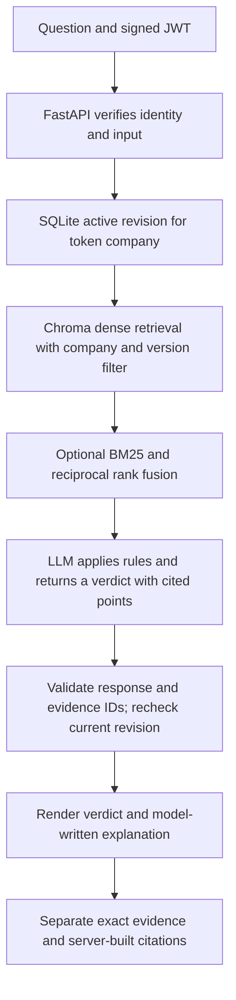

# CommuteLens — Commute Policy Assistant

MoveInSync campus case study B. A company-scoped policy assistant built with **Python, FastAPI, Chroma, local MiniLM embeddings, a real LLM and JWT**.

I chose B because its main flow is easier to explain, test and modify in a viva than a durable approval workflow or a secure SQL-generation service. The design combines a **model-written conclusion with server-built evidence**: the LLM applies the active policy to the question and returns Yes, No, a conditional explanation, a direct factual answer, or not covered. Exact quotations remain separate under **Check the evidence**. There are no question-specific or section-specific answer templates.

## Start with one command

With Docker Desktop running:

```sh
docker compose up --build
```

Open **[http://localhost:8000](http://localhost:8000)**. API documentation is at **[/docs](http://localhost:8000/docs)**. Docker Compose v2.24 or later is needed for the optional `.env` declaration. The first build installs dependencies and downloads the approximately 80 MB local embedding model. Later starts reuse the image and policy data volume.

On Windows, the alternative verified local path is:

```powershell
.\run.ps1
```

This uses `uv` to obtain Python 3.12, or an existing `py -3.12` installation, installs the pinned dependencies, and starts the app on localhost. On Linux/macOS with Python 3.12 installed, run `sh run.sh`.

### Configure a real LLM for the demo

Copy `.env.example` to `.env` if it does not already exist. Keep the actual file private.

For Gemini, set `LLM_PROVIDER=gemini` and `GEMINI_API_KEY` to your private free-tier AI Studio key. The default model is `gemini-3.5-flash-lite`, configurable through `GEMINI_MODEL`. One structured generation call selects supporting sections and writes the answer. Automatic retries are disabled to conserve quota. Legacy `GEMINI_SELECTION_MODE` and `GEMINI_DECISION_*` variables are ignored. Model availability and account quotas can vary.

For Groq, set `LLM_PROVIDER=groq`, `GROQ_API_KEY` and `GROQ_MODEL=openai/gpt-oss-20b`, using a **free plan**. No paid tools, search, automatic account upgrades, or automatic provider failovers are used.

For a download-free, key-free smoke demonstration, set `LLM_PROVIDER=fake` and `EMBEDDING_MODEL=hash-test` before startup. The interface explicitly labels the fake model. **This is for tests, not the real-LLM recording or latency claim.** Do not change embedding models inside an existing data directory; use a fresh `DATA_DIR` so stored and query vectors use the same model.

### Demo accounts

All accounts use the local demo password `commute-demo` unless you change `DEMO_PASSWORD`.

| Username | Company | Role |
| --- | --- | --- |
| `asha` | Atlas Labs | Employee |
| `bilal` | Beacon Works | Employee |
| `chitra` | Cedar Systems | Employee |
| `atlas-admin` | Atlas Labs | Policy administrator |
| `beacon-admin` | Beacon Works | Policy administrator |
| `cedar-admin` | Cedar Systems | Policy administrator |

The mock issuer looks up company and role in a server-side directory. It never accepts a company or role supplied by a login request. Tokens expire after 30 minutes and require the expected issuer, audience, algorithm, expiry and signature. This shared-password issuer is a local case-study service; a deployment would use the company's identity provider. `DEMO_MODE=false` disables the demo-token endpoint. Use a private random `JWT_SECRET` outside a local demonstration.

## Try these flows

1. Sign in as Asha. Ask **“When is a night shift security escort required?”** Atlas v1 says after 8 PM for women employees. Open the source document and check the same section.
2. Sign in as Bilal and ask the same question. Beacon says after 10 PM. Cedar says after 9 PM regardless of gender.
3. While signed in as Bilal, ask for Atlas Labs rules. The API returns `not_covered` with no citations and does not call the LLM.
4. Ask **“Are bicycle repairs reimbursed?”** The policies do not cover this; the assistant must abstain and direct you to the transport desk.
5. Sign in as Atlas admin, open **Publish a version**, and load the current document. The editor automatically increments the version. Change the night cutoff to 7 PM and publish. Ask again and check the new version. `examples/atlas-v2.json` contains a complete example.
6. Try a malformed document or an assistant-directed instruction in the editor. The active version remains intact if indexing or validation fails. See tests for deterministic failure injection rather than adding a failure endpoint to the public app.

The policies are small JSON documents with named sections, rather than PDFs. This preserves section boundaries and gives each citation an exact address. The three policies intentionally disagree on eligibility, escorts, cutoffs, weekend travel, airport approvals, guest travel and no-show penalties. They contain fictional rules, not MoveInSync's real policies.

## Design

### Functional and non-functional requirements


### System architecture


### Policy ingestion flow


### Request flow overview



### Responsibility boundaries

The LLM interprets the question, applies explicit scenario facts to the rules, and writes concise answer points. The general prompt requires comparisons of amounts, times and other limits, preserving relevant conditions and exceptions. Approval does not silently waive an independent cap. Missing personal facts produce a conditional explanation rather than an assumed profile. Open-ended questions receive direct facts or steps rather than forced Yes/No wording. Missing policy topics produce an explicit abstention.

Each response has a typed verdict and up to three answer points referencing retrieved section IDs. Python validates their shape and IDs; `app/answers.py` adds the verdict prefix and citation numbers. That renderer contains no business-rule parsing, keyword matching, company-specific values or sample answers. Document names, versions, titles and exact quotes come from stored policy data.

For the reported airport example, the intended conclusion is **No. INR 1,800 exceeds the INR 1,500 cap by INR 300; department-head approval meets the approval requirement but does not change the cap.** This illustrates the required interpretation, not a saved live response from the revised model.

Schema validation and exact citations do not prove generated reasoning is correct. The model can still misinterpret a rule or select incomplete evidence; there is no deterministic semantic verifier. Local mocked tests verify application behaviour. Live accuracy and latency for this revised generation path remain unmeasured because further API testing was declined to conserve quota.

### Company isolation

`/questions` accepts only `question` and `retrieval`. It rejects extra fields. The verified JWT chooses the company. SQLite resolves that company's active collection; Chroma applies company and version metadata filters inside it. Returned metadata is checked again before the text reaches the LLM. Policy reads and admin writes also use only the signed company.

An early name check refuses known foreign-company requests. This improves the user-facing response; it is **not** the security boundary. An obfuscated company name still cannot select another collection. The application does not offer an endpoint for querying a collection name directly. Clients with filesystem or direct database access are outside the API threat model.

### Atomic policy updates

Each revision gets a new immutable Chroma collection. The service validates the entire document, embeds every section, adds the sections, verifies the count and performs a full scoped vector read before changing a single active pointer in SQLite. Tiny indexes persist each write (`batch_size=1`, `sync_threshold=1`) to avoid leaving a short policy below Chroma's default persistence threshold. Under `BEGIN IMMEDIATE`, it rechecks that the version is greater than the current version and updates the pointer transactionally.

A failed build leaves the existing version active. A crash before the pointer commit can leave an unreachable staging collection. A crash after commit means the new revision is active even if the client did not receive its acknowledgement. Old revisions remain on disk for simplicity but are not selected for new questions. A question that started on an old revision rechecks the pointer after the LLM returns and is discarded if the revision changed. The demo uses one API worker; stronger guarantees across multiple processes would need additional coordination.

### Untrusted documents and output

The prompt marks questions and evidence as untrusted data. An admission filter rejects recognizable assistant-directed instructions in a policy. The filter is a defence in depth, not a complete detector. The stronger controls are fixed retrieval scope, no model tools, a strict response schema, retrieved-ID validation and server-built citations. Malicious text cannot grant another tenant's access or execute a command. A compromised policy administrator can publish false facts, and the model may select a misleading section or generate an unsupported interpretation; trusted document ownership and semantic evaluation remain necessary.

The browser uses DOM `textContent` for answers and policy text, so returned document strings are not interpreted as HTML.

### Latency and call budgets

Normal Gemini and Groq requests make **one LLM call**, combining evidence selection and a concise answer. Automatic retries and a second grading call are disabled to conserve quota. Output is capped at 512 tokens and three distinct cited chunks. Orchestration still enforces at most two calls if a fallback is explicitly injected; none is configured by default. There is no answer cache or query rewriting.

The total deadline remains 2.8 seconds; retrieval has a 650 ms sub-budget. The model receives only the remaining time. HTTP connections are reused, and local ONNX inference uses two CPU threads with idle spinning disabled. A bounded semaphore limits outstanding retrieval work because cancelling a Python thread does not kill it. SQLite lock waits are bounded. A quick error is not a successfully answered request.

**The revised generation path has not been live-benchmarked.** Earlier 28/28 results and p95 2.03 seconds in `artifacts/direct-answers/` describe the previous decision-selector/template implementation and cannot establish this revision's accuracy or latency. Historical results remain available. Current changes were checked with mocked provider responses only; no Gemini quota was used.

### Retrieval bonus

The baseline is Chroma cosine dense search with `all-MiniLM-L6-v2`. The bonus combines its top six candidates with BM25 over the current policy sections using reciprocal rank fusion, `score = sum(1 / (60 + rank))`. It selects the top three fused sections without another LLM call or model download.

The evaluator alternates method order on the **same fixed gold set**, reporting Recall@3, MRR@3, answer quality and retrieval/total latency. Hybrid search adds tokenisation and a small BM25 pass over at most 40 short sections. It is an experiment, not an assumed improvement. On tiny clean documents, dense search can already retrieve every required section.

## Rerun the tests and evaluation

From an installed local environment:

```powershell
.venv\Scripts\python.exe -m pytest -q
.venv\Scripts\python.exe -m evaluation.run --provider fake --embedding hash-test --output artifacts/offline-smoke
```

On Linux/macOS use `.venv/bin/python` instead. In Docker:

```sh
docker compose exec assistant python -m pytest -q
docker compose exec assistant python -m evaluation.run --provider fake --embedding hash-test --output /tmp/evaluation
```

Tests use real Chroma with deterministic test embeddings and fake provider outputs. They need no API key, network or model download. They cover signed identity, cross-company traps, contradictory answers, atomic and partial ingestion failures, index-readiness checks, concurrent publishers, restart persistence, stale in-flight answers, invalid response/verdict/evidence combinations, injected bounded fallback, non-retryable failures and distinct deadlines.

The evaluation set has **28 manually verified questions**, including semantic paraphrases, cross-company traps, uncovered questions, a boundary, injection attempts and compound questions. `evaluation/questions.jsonl` holds the frozen inputs and gold expectations. Each generated result row contains the required `id`, `input`, `expected`, `actual`, `pass` and `notes` fields. `summary.json` contains the aggregate metrics. Re-running evaluation uses a fresh temporary policy store, so a demo policy update does not invalidate the gold set.

For the real provider and real embeddings:

```powershell
.venv\Scripts\python.exe -m evaluation.run --provider gemini --embedding minilm --delay 7 --output artifacts/live
# Or, with a free Groq key configured:
.venv\Scripts\python.exe -m evaluation.run --provider groq --embedding minilm --delay 7 --output artifacts/live-groq
```

The pacing delay is outside the timed request. Adjust it to the free project's published quota; quota errors are recorded as failures and are not silently retried. The evaluator records all results and exits normally by default so a reviewer can inspect failures. Add `--strict` to return a nonzero exit code if any case fails. Fake-model scores demonstrate pipeline behaviour and are clearly separated from real-model answer quality and latency.

Rubric version 2 checks the explicit verdict, essential conditions/facts using documented regex alternatives, known contradictions, status, exact section set, source citation fidelity, company and call/chunk budgets. The original 28 question inputs are unchanged. Alternative acceptable verdicts (such as yes-with-conditions or conditional) still require every relevant condition. Case-level fact results are recorded separately. The old `legacy_contains` values remain for audit only and no longer decide the score. These deterministic checks accept selected paraphrases and normalized numbers/times; they are not a complete semantic proof and unknown wording needs human review. Negative cases require explicit abstention and no citations. Retrieval Recall@3 is computed on answerable questions. p95 uses nearest rank over wall-clock local API calls, including LLM time. First provider connection time is included. The summary also reports retry counts and successful-response latency so quick failures cannot inflate the claim.

## API

| Method | Path | Purpose |
| --- | --- | --- |
| `POST` | `/auth/demo-token` | Mock issuer; username/password only |
| `GET` | `/me` | Verified session identity |
| `GET` | `/policy` | This company's current document |
| `POST` | `/questions` | Ask with `question` and optional `retrieval` (`dense` or `hybrid`) |
| `POST` | `/admin/policy` | Publish a complete higher policy version; own-company administrator only |
| `GET` | `/health` | Readiness and non-secret configuration |

Business outcomes use a typed `status`: `answered`, `not_covered` or `try_again`. Authentication/input/administration errors use standard HTTP error codes with plain messages. Raw database errors, model response bodies, keys and stack traces are never returned to employees.

## Trade-offs and limits

- Responses use general model reasoning over policy text. A strict schema and exact citations make responses inspectable but do not guarantee semantic correctness. Missing employee facts stay conditional; no operational booking or escort assignment is claimed.
- Complete section-level JSON ingestion preserves meaning and citations. It does not handle PDFs, OCR, complex tables, contradictory rules inside one policy, or multilingual documents.
- One worker, embedded Chroma and a small SQLite registry keep the demo understandable. This is not a distributed production architecture; dormant revision cleanup and operational observability are future work.
- The fixed 28-case gold set is a useful regression suite, not a representative statistical estimate for every employee question. Report real model failures and provider dependence honestly.
- No answer cache or query rewriting is used, so the retrieval experiment stays simple and every live semantic answer genuinely includes the LLM call.

## Submission and viva material

- [Evaluation report](docs/EVALUATION_REPORT.md) and raw JSONL/summary files under `artifacts/`.
- [Requirement mapping](docs/REQUIREMENTS.md).
- [Viva guide](docs/VIVA_GUIDE.md): short explanation, architecture, trade-offs, likely questions and five live-change exercises.
- [Two-minute demo sequence and speaking points](docs/DEMO_SCRIPT.md). You will record the running app with your own voice.
- [Submission checklist](docs/SUBMISSION.md): remaining account-level steps, evidence and secret checks.

### Technical references

Implementation references: [Chroma Python collection API](https://docs.trychroma.com/reference/python/collection), [Gemini structured outputs](https://ai.google.dev/gemini-api/docs/structured-output), [Gemini free-tier pricing](https://ai.google.dev/gemini-api/docs/pricing), [Groq API compatibility](https://console.groq.com/docs/openai), and [Groq free-plan rate limits](https://console.groq.com/docs/rate-limits). Account quotas and model availability should be checked again before the recording.

## Scoring and demo test commands

To show all automated tests without API usage:

```powershell
docker compose exec -T assistant python -m pytest -q
```

If running without Docker:

```powershell
.venv\Scripts\python.exe -m pytest -q
```

Use `-v` instead of `-q` to list each test. The final `N passed` line is the automated-test result. These tests include injected provider outputs and scorer regression fixtures; they do not establish that all 28 real LLM answers pass. For the recording say: "All automated tests pass; the test suite uses mocked LLM outputs and consumes no API quota."

Saved evaluation responses can be rescored without contacting a provider:

```powershell
.venv\Scripts\python.exe -m evaluation.rescore --input artifacts/direct-answers/hybrid.jsonl --output artifacts/rescored/hybrid.jsonl
```

This command preserves the original file and applies the current gold rubric. Historical responses missing the new verdict field fail that check; the tool never guesses or invents a verdict. Rescoring is not a new generation run or a new latency measurement. No rescored historical result should be presented as current-model accuracy. Live evaluation remains opt-in and uses API quota.
